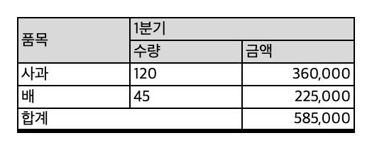
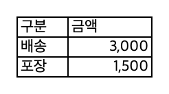
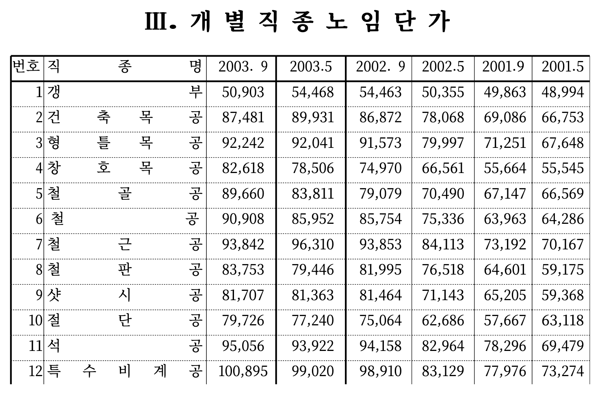
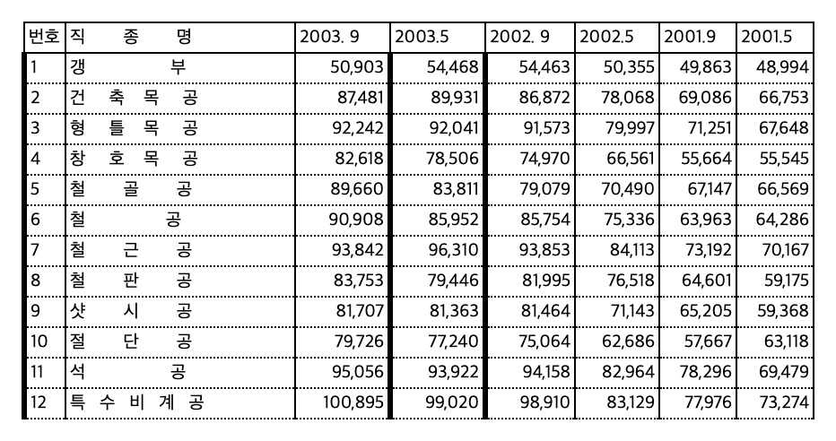

# hwp3 — parser and converter for HWP 3.x (Hangul 3.0/96/97) documents

[한국어](README.md) | English

Documents saved by the Korean word processor Hangul (HWP 3.x) in the 1990s are hard to open with current tools. This library reads HWP 3.x files directly, following the "Hangul Document File Format 3.0" specification published by Hancom, and converts them to JSON, text, HTML, CSV and Excel.

- Extracts paragraphs, tables, text boxes, footnotes, headers and footers, and text inside drawing objects, keeping the structure.
- Exports tables to Excel with merged cells and borders. Old-style tables drawn with box-drawing characters are split into cells too.
- Draws pages as SVG, following the line and page layout that Hangul 97 stored in the file.
- Parsing and the JSON, text, HTML and CSV exports use only the Python standard library.

HWP5 (`.hwp` from Hangul 2002 onward) and HWPX are not supported.

Most output labels, sheet names and messages are in Korean, because the documents are.

## Example

`examples/sample.hwp` is a small document whose bytes were assembled by hand from the specification (built by `examples/make_sample.py`; the content is made up). It has one table with merged cells, one footnote and one table drawn with box-drawing characters.

```
hwp3 convert examples/sample.hwp -o out --xlsx --numbers
```

`out/text.txt`

```
과일 가게 견적서 (예시)
아래 숫자는 hwp3 예시를 위해 지어낸 것이다.[각주: 실제 가격이 아니다.]

[표 T0 5x3 쪽=None]
품목	1분기	
	수량	금액
사과	120	360,000
배	45	225,000
합계		585,000
[/표 T0]
부대 비용
┌────┬────────┐
│구분│금액    │
├────┼────────┤
│배송│   3,000│
│포장│   1,500│
└────┴────────┘
끝.
```

`out/tables/T000.csv`

```
품목,1분기,
,수량,금액
사과,120,"360,000"
배,45,"225,000"
합계,,"585,000"
```

`out/document.xlsx` gets four sheets: `본문` (body text), `목록` (index of tables), `T001` and `X001`. Merged cells, shading and thick borders carry over, and the box-drawing table is split into cells.

| Table sheet `T001` | Box-drawing table sheet `X001` |
|---|---|
|  |  |

This is what a real document looks like. The left image is the page view (`--pages`) and the right one is the Excel sheet of the same table (`--xlsx --numbers`). Both are cropped to the top part.

| Page view | Excel |
|---|---|
|  |  |

Source of the document: Construction Association of Korea, wage survey report for the construction industry applied in the first half of 2004 (대한건설협회, 「2004년 상반기 적용 건설업 임금실태 조사 보고서」), part of page 8. The original file is not in this repository.
The Excel images show the generated `.xlsx` opened with macOS Quick Look.

## What it was checked against

It is a general parser that follows the specification, not one tuned to a particular kind of document. So far it has been checked with 54 documents.

| Input | Result |
|---|---|
| 33 public HWP3 test files (from rhwp, java-hwp, the LibreOffice test data and others; forms, a document with more than 20,000 paragraphs, equations and drawing objects) | 32 parsed, 1 password-protected file rejected |
| 22 construction wage survey reports from 1998–2004 | all parsed without warnings |
| 48 deliberately corrupted files | all rejected with an error (no unhandled exception) |
| 13 documents that Hancom Office converted to HWPX | the grids of all 131 tables match |
| 23 documents that have a Hancom conversion or PDF | no Hangul text from the Hancom side is missing from the output |

This does not guarantee that every HWP 3.x document works. See "Limits" below.

## Features

| What it does | Needs |
|---|---|
| Read the document structure (paragraphs, tables, text boxes, equations, buttons, pictures, footnotes, headers and footers, text in drawing objects) | nothing |
| Export JSON, text, HTML and table CSV | nothing |
| Hancom-style view (the same table grid Hancom Office produces when converting to HWPX) | nothing |
| Export Excel (`.xlsx`) | openpyxl |
| Page view (one SVG per page and a single-file HTML viewer) | fontTools and brotli to embed fonts, Pillow to convert pictures |

PDF and HWPX export are not there yet.

## Install

Python 3.11 or later.

```
pip install "hwp3[all] @ git+https://github.com/kimi230/hwp3"    # with Excel and page view
pip install "git+https://github.com/kimi230/hwp3"                # parsing and JSON, text, HTML, CSV only
```

From a clone, run `pip install ".[all]"` in the folder, or skip installation and put `src/` on the path: `PYTHONPATH=src python -m hwp3 …`

## Command line

```
hwp3 info <file.hwp>
hwp3 convert <file.hwp> -o <folder> [--hancom] [--pages] [--xlsx [--xlsx-view raw] [--numbers]]
hwp3 fonts
```

| Output | Content |
|---|---|
| `document.json` | The whole document structure (schema `hwp3-document/1`). Characters that could not be mapped are listed in `unknown_codes` |
| `text.txt` | Body text |
| `document.html` | HTML including tables |
| `tables/T###.csv` | Tables in their original grid |
| `hancom/` (`--hancom`) | The document seen the way Hancom's HWPX conversion shows it: text boxes become tables, holes in grids are filled, the ')' after footnote numbers is dropped, equations are separated |
| `pages/` (`--pages`) | One SVG per page and a single-file viewer `index.html`, following the line and page layout stored by Hangul 97 |
| `document.xlsx` (`--xlsx`) | Excel workbook: sheets `본문` (body) and `목록` (index), one sheet per table (`T###`) and per box-drawing table (`X###`) |

Excel options

- `--xlsx-view hancom` (default): Hancom-style grid; sheet names match `hancom/tables/T###.csv`. `raw`: original grid; sheet names match `tables/T###.csv`.
- `--numbers`: converts only comma-grouped numbers (`56,352`) to numbers. By default every cell keeps its original text.
- Merged cells, borders, diagonals, shading, vertical alignment, font size, column widths and row heights are carried over. Horizontal alignment, font names, bold and pictures are not.
- Table positions (page and paragraph numbers) and captions are in the `목록` sheet.

Page view options

- `--soffice <path to soffice>`: converts WMF and EMF pictures to PNG with LibreOffice (optional).

## Python

```python
from hwp3 import parse_file, HWP3Error
from hwp3 import compat                 # Hancom-style view
from hwp3.render import write_pages     # page view
from hwp3.xlsx import write_xlsx        # Excel (needs openpyxl)

doc = parse_file("x.hwp")               # password-protected or broken files raise HWP3Error
for t in doc.iter_tables():             # document order, nested tables included
    if t.box_type == "table":
        rows = t.matrix()               # rows × columns of strings (a merged cell appears only at its top-left)
        problems = t.grid_problems()    # holes and overlaps
text = compat.text(doc)                 # body text without duplicates (Hancom style)
views = list(compat.table_views(doc))   # the same grids as Hancom's HWPX
doc.unknown_chars                       # {HNC code: count}: Hancom-only characters with no known mapping
write_xlsx(doc, "out.xlsx", view="hancom", numbers=False)   # view="raw" keeps the original grid
```

- When joining body text yourself, use only the strings in `Paragraph.items`. `export._para_plain` also puts text-box text into the enclosing paragraph, so combining it with `iter_paragraphs()` yields the same text twice.
- Page numbers: `Table.page`, `Paragraph.page` (only for documents with stored layout; otherwise `None`).

## Fonts (page view)

Noto Serif KR and Noto Sans KR stand in for the Hancom fonts. Both are bundled in `src/hwp3/fonts/` (about 34 MB, SIL OFL 1.1), so nothing has to be installed separately.
To use other font files, rely on the lookup order. `hwp3 fonts` shows where each font was found.

1. Environment variable `HWP3_FONT_DIR`
2. `hwp3/fonts/` inside the package
3. Operating system font folders (`~/Library/Fonts` and others on macOS; `~/.local/share/fonts`, `/usr/share/fonts` and others on Linux; `%WINDIR%\Fonts` on Windows)

## Limits

- Password-protected documents are not opened.
- The page view substitutes Noto Serif/Sans KR for the Hancom fonts.
- For HWP3 files without stored positions (saved by other programs), the page view uses a computed layout and is approximate.
- Multiple columns, page borders, WordArt-style text (글맵시) and OLE objects are not drawn.
- Some Hancom-only characters have no known mapping and stay unknown (for example 0x3073, 0x3078, 0x25F1). They are written as `□` on export.
- It has been run only on macOS. Linux and Windows are untested.
- Excel files were checked with openpyxl, LibreOffice and macOS Quick Look. They have not been opened in Microsoft Excel yet.

## Development

```
pip install -e ".[test]"
pytest                      # 81 tests; those needing openpyxl, fontTools or brotli are skipped when missing
```

- Do not edit the supplementary character table `src/hwp3/hnc_table.tsv` by hand. It was generated from the source tables by a script (the script is not in this repository yet).
- Converters do not modify the source model (`Document`).

## License

MIT (`LICENSE`). Two parts have different terms.

- `src/hwp3/symbols.py`: ported from the conversion rules in LibreOffice hwpfilter, so it is under MPL 2.0 (`LICENSES/MPL-2.0.txt`).
- The Noto fonts in `src/hwp3/fonts/`: SIL OFL 1.1.

Sources and terms of the bundled fonts and character tables are in `src/hwp3/THIRD_PARTY.md` (in Korean; it is installed with the package).

## Notice

This product was developed with reference to the Hangul document file (.hwp) specification published by Hancom Inc.
(본 제품은 한글과컴퓨터의 한글 문서 파일(.hwp) 공개 문서를 참고하여 개발하였습니다.)

"Hangul" (한글), "Hancom" and "HWP" are trademarks of Hancom Inc. This project is an independent open-source project and is not affiliated with, sponsored by or endorsed by Hancom.
