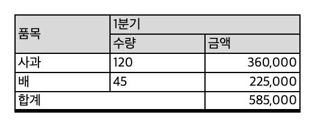
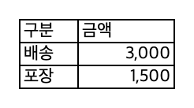
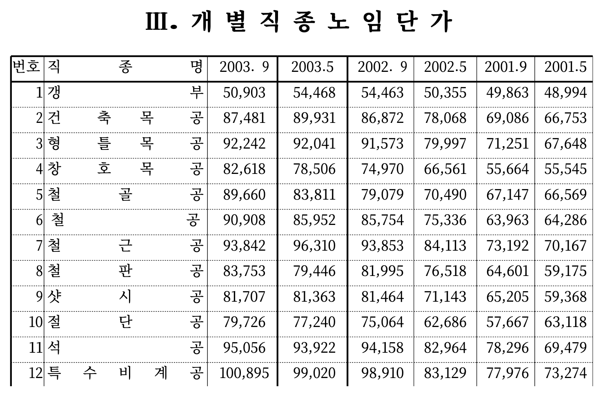
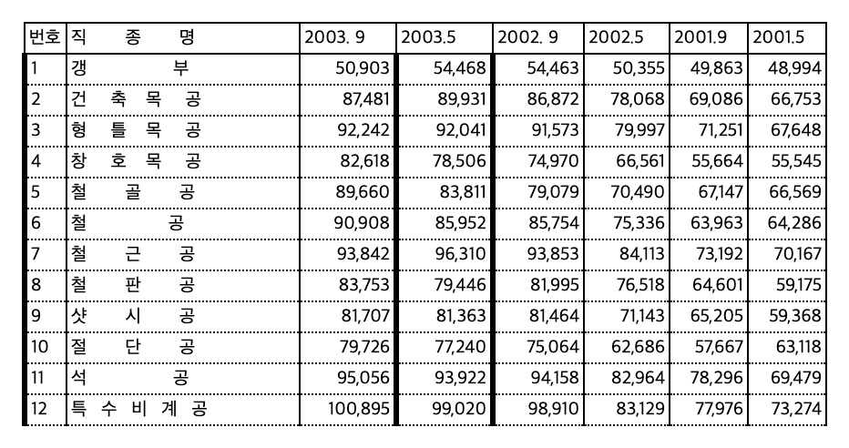

# hwp3 — HWP 3.x(한글 3.0/96/97) 문서 읽기와 변환

한국어 | [English](README.en.md)

1990년대 한글(HWP 3.x)로 저장된 문서는 요즘 도구로 열기 어렵다. 이 라이브러리는 한글과컴퓨터가 공개한 「한글 문서 파일 형식 3.0」 규격을 따라 HWP 3.x 파일을 직접 읽고 JSON·텍스트·HTML·CSV·엑셀로 바꾼다.

- 문단, 표, 글상자, 각주, 머리말·꼬리말, 그리기 개체 안의 글을 구조 그대로 꺼낸다.
- 표는 병합·테두리까지 살려 엑셀로 내보낸다. 괘선 문자로 그린 옛날식 표도 칸으로 나눈다.
- 한글 97이 저장한 줄·쪽 배치를 따라 쪽 모양을 SVG로 그린다.
- 해석과 JSON·텍스트·HTML·CSV 내보내기는 표준 라이브러리만 쓴다.

HWP5(`.hwp`, 한글 2002 이후)와 HWPX는 읽지 않는다.

## 예시

`examples/sample.hwp`는 규격대로 바이트를 직접 조립한 작은 문서다(`examples/make_sample.py`가 만든다. 내용은 지어낸 것이다). 병합 칸이 있는 표 하나, 각주 하나, 괘선 문자로 그린 표 하나가 들어 있다.

```
hwp3 convert examples/sample.hwp -o out --xlsx --numbers
```

`out/text.txt`

```
과일 가게 견적서 (예시)
아래 숫자는 hwp3 예시를 위해 지어낸 것이다.[각주: 실제 가격이 아니다.]

[표 T0 5x3 쪽=None]
품목	1분기	
	수량	금액
사과	120	360,000
배	45	225,000
합계		585,000
[/표 T0]
부대 비용
┌────┬────────┐
│구분│금액    │
├────┼────────┤
│배송│   3,000│
│포장│   1,500│
└────┴────────┘
끝.
```

`out/tables/T000.csv`

```
품목,1분기,
,수량,금액
사과,120,"360,000"
배,45,"225,000"
합계,,"585,000"
```

`out/document.xlsx`에는 시트 네 개(`본문`, `목록`, `T001`, `X001`)가 생긴다. 표의 병합·음영·굵은 선이 그대로 가고, 괘선 문자 표도 칸으로 나뉜다.

| 표 시트 `T001` | 괘선 문자 표 시트 `X001` |
|---|---|
|  |  |

실제 문서로는 이렇게 나온다. 왼쪽은 쪽 보기(`--pages`), 오른쪽은 같은 표의 엑셀 시트(`--xlsx --numbers`)이고 둘 다 위쪽 일부만 잘랐다.

| 쪽 보기 | 엑셀 |
|---|---|
|  |  |

문서 출처: 대한건설협회, 「2004년 상반기 적용 건설업 임금실태 조사 보고서」 8쪽 일부. 원본 파일은 이 저장소에 없다.
엑셀 그림은 만든 `.xlsx`를 macOS 훑어보기로 연 화면이다.

## 확인한 범위

특정 문서 종류에 맞춘 것이 아니라 규격대로 읽는 범용 파서다. 지금까지 문서 54개로 확인했다.

| 대상 | 결과 |
|---|---|
| 공개 HWP3 시험 파일 33개(rhwp, java-hwp, LibreOffice 시험 자료 등. 양식, 2만 문단이 넘는 문서, 수식·그리기 개체 포함) | 32개 해석, 암호 문서 1개 거부 |
| 1998~2004년 건설업 임금실태조사 보고서 22개 | 모두 경고 없이 해석 |
| 일부러 깨뜨린 파일 48개 | 모두 오류로 거부(처리되지 않은 예외 없음) |
| 한컴오피스가 같은 문서를 HWPX로 바꾼 13개 | 표 131개의 격자가 모두 같음 |
| 한컴 변환본·PDF가 있는 23개 | 한컴 쪽 한글이 출력에서 빠진 경우 없음 |

모든 HWP 3.x 문서에서 된다고 보장하지는 않는다. 아래 '한계'를 함께 본다.

## 기능

| 할 수 있는 것 | 필요한 것 |
|---|---|
| 문서 구조 읽기(문단, 표·글상자·수식·버튼, 그림, 각주, 머리말·꼬리말, 그리기 개체 글) | 없음 |
| JSON, 텍스트, HTML, 표 CSV 내보내기 | 없음 |
| 한컴식 보기(한컴오피스가 HWPX로 바꿀 때와 같은 표 격자) | 없음 |
| 엑셀(`.xlsx`) 내보내기 | openpyxl |
| 쪽 보기(쪽마다 SVG와 한 파일 HTML 뷰어) | 글꼴을 넣으려면 fontTools·brotli, 그림 변환에 Pillow |

PDF·HWPX 내보내기는 아직 없다.

## 설치

파이썬 3.11 이상.

```
pip install "hwp3[all] @ git+https://github.com/kimi230/hwp3"    # 엑셀·쪽 보기까지
pip install "git+https://github.com/kimi230/hwp3"                # 해석과 JSON·텍스트·HTML·CSV만
```

저장소를 받아서 쓰려면 그 폴더에서 `pip install ".[all]"`을 하거나, 설치하지 않고 `src/`를 경로에 넣는다: `PYTHONPATH=src python -m hwp3 …`

## 명령행

```
hwp3 info <파일.hwp>
hwp3 convert <파일.hwp> -o <폴더> [--hancom] [--pages] [--xlsx [--xlsx-view raw] [--numbers]]
hwp3 fonts
```

| 출력 | 내용 |
|---|---|
| `document.json` | 문서 전체 구조(schema `hwp3-document/1`). 모르는 글자는 `unknown_codes`로 기록 |
| `text.txt` | 본문 텍스트 |
| `document.html` | 표를 포함한 HTML |
| `tables/T###.csv` | 원본 격자 그대로의 표 |
| `hancom/`(`--hancom`) | 한컴 HWPX와 같은 모양으로 본 결과. 글상자→표, 빈칸 채우기, 각주 ')' 정리, 수식 분리 |
| `pages/`(`--pages`) | 쪽마다 SVG와 한 파일 뷰어 `index.html`. 한글 97이 저장한 줄·쪽 배치를 따른다 |
| `document.xlsx`(`--xlsx`) | 엑셀. `본문`·`목록` 시트와 표마다 시트 하나(`T###`), 괘선 글자 표(`X###`) |

엑셀 옵션

- `--xlsx-view hancom`(기본): 한컴식 격자. 시트 이름이 `hancom/tables/T###.csv`와 같다. `raw`: 원본 격자. 시트 이름이 `tables/T###.csv`와 같다.
- `--numbers`: 쉼표 숫자(`56,352`)만 숫자로 바꾼다. 기본은 원문 글자 그대로다.
- 병합, 테두리, 대각선, 음영, 세로 정렬, 글자 크기, 열 너비·행 높이를 옮긴다. 가로 정렬·글꼴 이름·굵게·그림은 옮기지 않는다.
- 표 위치(쪽·문단 번호)와 표 제목은 `목록` 시트에 있다.

쪽 보기 옵션

- `--soffice <soffice 경로>`: WMF·EMF 그림을 LibreOffice로 PNG로 바꾼다(선택).

## 파이썬

```python
from hwp3 import parse_file, HWP3Error
from hwp3 import compat                 # 한컴식 보기
from hwp3.render import write_pages     # 쪽 보기
from hwp3.xlsx import write_xlsx        # 엑셀(openpyxl 필요)

doc = parse_file("x.hwp")               # 암호 문서·깨진 파일은 HWP3Error
for t in doc.iter_tables():             # 문서 순서, 표 안 표 포함
    if t.box_type == "table":
        rows = t.matrix()               # 행×열 문자열(병합 칸은 왼쪽 위에만)
        problems = t.grid_problems()    # 빈칸·겹침
text = compat.text(doc)                 # 중복 없는 본문 글(한컴식)
views = list(compat.table_views(doc))   # 한컴 HWPX와 같은 격자
doc.unknown_chars                       # {HNC 코드: 횟수}. 근거 없는 한컴 전용 글자
write_xlsx(doc, "out.xlsx", view="hancom", numbers=False)   # view="raw"는 원본 격자
```

- 본문 글을 직접 이을 때는 `Paragraph.items`의 문자열만 써야 한다. `export._para_plain`은 글상자 글을 바깥 문단에도 넣으므로, `iter_paragraphs()`와 함께 쓰면 같은 글이 두 번 들어간다.
- 쪽 번호: `Table.page`, `Paragraph.page`(배치가 저장된 문서만. 아니면 `None`).

## 글꼴(쪽 보기)

한컴 글꼴 대신 Noto Serif KR·Noto Sans KR을 쓴다. 두 글꼴은 `src/hwp3/fonts/`에 들어 있어(약 34MB, SIL OFL 1.1) 따로 설치하지 않아도 된다.
다른 글꼴 파일을 쓰려면 찾는 순서를 이용한다. `hwp3 fonts`가 어디서 찾았는지 보여 준다.

1. 환경변수 `HWP3_FONT_DIR`
2. 패키지 안 `hwp3/fonts/`
3. 운영체제 글꼴 폴더(맥 `~/Library/Fonts` 등, 리눅스 `~/.local/share/fonts`·`/usr/share/fonts` 등, 윈도 `%WINDIR%\Fonts`)

## 한계

- 암호 문서는 열지 않는다.
- 쪽 보기는 Noto Serif/Sans KR로 한컴 글꼴을 대신한다.
- 위치가 저장되지 않은 HWP3(다른 프로그램이 저장한 것)의 쪽 보기는 계산 배치라 근사다.
- 다단, 쪽 테두리, 글맵시, OLE는 그리지 않는다.
- 일부 한컴 전용 글자는 근거가 없어 모름으로 남는다(예: 0x3073, 0x3078, 0x25F1). 내보낼 때 `□`로 쓴다.
- 맥에서만 돌려 봤다. 리눅스·윈도에서는 확인하지 않았다.
- 엑셀 파일은 openpyxl, LibreOffice, macOS 훑어보기로 확인했다. 마이크로소프트 엑셀에서는 아직 열어 보지 않았다.

## 고칠 때

```
pip install -e ".[test]"
pytest                      # 81건. openpyxl·fontTools·brotli가 없으면 해당 시험을 건너뛴다
```

- 글자 보충표 `src/hwp3/hnc_table.tsv`는 손으로 고치지 않는다. 출처 표에서 스크립트로 만든 것이다(생성 스크립트는 아직 이 저장소에 없다).
- 변환기는 원본 모델(`Document`)을 바꾸지 않는다.

## 라이선스

MIT(`LICENSE`). 아래 두 가지만 조건이 다르다.

- `src/hwp3/symbols.py`: LibreOffice hwpfilter의 변환 규칙을 옮긴 파일이라 MPL 2.0을 따른다(`LICENSES/MPL-2.0.txt`).
- `src/hwp3/fonts/`의 Noto 글꼴: SIL OFL 1.1.

함께 들어 있는 글꼴과 글자표의 출처·조건은 `src/hwp3/THIRD_PARTY.md`에 있다(설치하면 패키지 폴더에 함께 들어간다).
